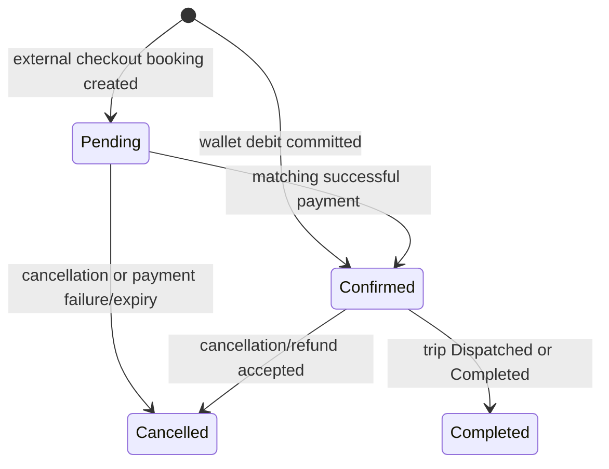

# Booking lifecycle and capacity rules

**Audience:** developers, reviewers, and Component D testers.

**Source baseline:** `c2e792bfb0ec21db632e1f85815d7c1380e8a432` (`main`), reviewed 2026-10-16.

**Purpose:** explain the implemented booking rules, including the differences between wallet bookings and external checkout. This is a source review; it does not certify a live deployment.

## Entry points and identities

The routes below are relative to `/api/v1`. `DispatchStaff` means Admin, CentreManager, or Dispatcher, as defined in [AppRoles](../../apps/backend/api/Common/Constants/AppRoles.cs).

| Route | Caller | Result |
| --- | --- | --- |
| `POST /bookings` | DispatchStaff | Creates a wallet-funded booking for the supplied passenger. |
| `POST /bookings/me` | Commuter | Resolves the passenger from the authenticated user before wallet booking. |
| `POST /payments/checkout` | DispatchStaff | Starts external checkout for the supplied passenger. |
| `POST /payments/checkout/me` | Commuter | Resolves the caller's passenger and starts Stripe checkout. |
| `GET /bookings/me` | Commuter | Returns tickets linked to the caller's passenger profile. |
| `DELETE /bookings/{bookingId}` | DispatchStaff | Cancels using a required reason; refund behavior depends on payment history. |
| `PATCH /bookings/{bookingId}/status` | DispatchStaff | Supports the completion rule described below. |

Sources: [BookingsController](../../apps/backend/api/Controllers/BookingsController.cs), [PaymentsController](../../apps/backend/api/Controllers/PaymentsController.cs), and [BookingRequests](../../apps/backend/api/DTO/Bookings/BookingRequests.cs). The commuter routes do not accept an arbitrary passenger ID. A commuter self-service cancellation route is not declared in this controller.

## Creation preconditions

Both payment paths require an active passenger, a vehicle with positive capacity, an active standard fare for the trip's route, and a passenger count from 1 through 10. Booking is open only when the scheduled departure is strictly later than the server's current UTC time and the trip is Scheduled, Ready, or Boarding. A future Delayed trip does not satisfy this creation rule.

The stored total fare is `active route fare × passenger count`. For example, a synthetic route fare of LKR 250 and three passengers produces a LKR 750 booking. The wallet path must have at least that balance; it debits the wallet and records a Fare transaction in the same database transaction as the booking.

## State transitions

For card payment, cancellation after provider acceptance means a refund is requested; it does not mean the provider has completed the refund. A rejected refund request leaves the booking active. A late successful checkout event can update payment state, but `MarkPaidAsync` confirms only a booking that is still Pending; it does not reactivate a Cancelled booking.

Completion requires both a Confirmed booking and a requested status of Completed, with the trip Dispatched or Completed. The status endpoint is not a general-purpose state editor. Completed and Cancelled bookings cannot be cancelled through the ordinary cancellation service.

Sources: [BookingService](../../apps/backend/api/Services/BookingService.cs), [BookingCancellationService](../../apps/backend/api/Services/BookingCancellationService.cs), and [BookingPaymentService](../../apps/backend/api/Services/BookingPaymentService.cs).

## Capacity and boarding references

Occupied capacity is the sum of `PassengerCount` for Pending and Confirmed bookings. A pending checkout therefore holds capacity. A group booking consumes multiple spaces even though it has one booking record and one generated boarding reference. The internal `SeatNumber` field is generated by the server; it is not a user-selected numbered seat in this implementation.

The wallet path locks and reloads the trip and wallet before checking eligibility, funds, and occupied capacity again. Checkout inserts the pending booking under a trip lock and repeats its capacity check before contacting the provider. The repository implements the capacity calculation; the filtered unique index on `(TripId, SeatNumber)` alone does not enforce vehicle capacity.

Sources: [BookingRepository](../../apps/backend/api/Repositories/BookingRepository.cs) and [BookingConfiguration](../../apps/backend/api/Data/Configurations/BookingConfiguration.cs).

## Ticket visibility is a separate decision

A Confirmed booking can board while booking remains open, or while its trip is Boarding/Delayed and inside the active window. The window ends at actual departure, falling back to scheduled departure, plus estimated duration and a 60-minute buffer. Duration comes from the route direction, then route, then a 60-minute fallback. A Dispatched trip can remain in the Upcoming group inside that window while `CanBoard` is false.

Commuter ticket and booking-detail responses omit the QR code when boarding is not allowed. Ticket grouping (Upcoming, Past, Cancelled) is derived at read time and is not an additional stored booking status. Sources: [BookingEligibility](../../apps/backend/api/Services/BookingEligibility.cs) and [BookingResponses](../../apps/backend/api/DTO/Bookings/BookingResponses.cs).

## Review checks

Check the exact departure-time boundary, a group larger than remaining capacity, insufficient balance, repeated wallet cancellation, a pending card hold, late payment after cancellation, and completion before dispatch. Existing cases are in [BookingApiTests](../../apps/backend/api.Tests/Bookings/BookingApiTests.cs), [PaymentCheckoutTests](../../apps/backend/api.Tests/Bookings/PaymentCheckoutTests.cs), and [BookingEligibilityTests](../../apps/backend/api.Tests/Bookings/BookingEligibilityTests.cs). Their presence is not a new execution result.
